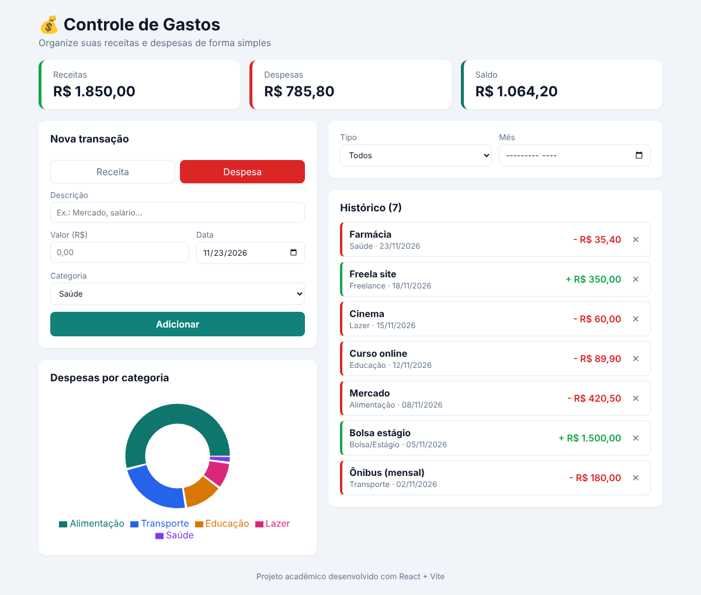

# 💰 Controle de Gastos — React.js

Aplicação web para controle de finanças pessoais: cadastre receitas e despesas, acompanhe o saldo, filtre por tipo e mês e veja um gráfico das despesas por categoria. Os dados ficam salvos no próprio navegador (`localStorage`).

Projeto acadêmico desenvolvido para estudar o framework **React.js**.



---

## 📑 Sumário

1. [Sobre o React.js](#-sobre-o-reactjs)
2. [Conceitos do React usados no projeto](#-conceitos-do-react-usados-no-projeto)
3. [Funcionalidades](#-funcionalidades)
4. [Tecnologias](#-tecnologias)
5. [Pré-requisitos](#-pré-requisitos)
6. [Passo a passo: instalação e execução](#-passo-a-passo-instalação-e-execução)
7. [Estrutura de pastas](#-estrutura-de-pastas)
8. [Scripts disponíveis](#-scripts-disponíveis)
9. [Referências](#-referências)

---

## ⚛️ Sobre o React.js

O **React** é uma biblioteca JavaScript de código aberto para construir interfaces de usuário (UI). Foi criada pelo Facebook (hoje Meta) em 2013 e é mantida pela Meta e pela comunidade. Embora tecnicamente seja uma *biblioteca*, é comum chamá-la de *framework* porque, junto com seu ecossistema (React Router, Vite, Next.js etc.), ela forma a base de aplicações completas.

### Principais características

| Característica | O que significa |
|---|---|
| **Baseado em componentes** | A interface é dividida em peças independentes e reutilizáveis (botões, formulários, listas). Cada componente cuida da própria aparência e comportamento. |
| **Declarativo** | Você descreve *como a tela deve ficar* para cada estado, e o React se encarrega de atualizar o DOM. Não é preciso manipular elementos manualmente (`document.getElementById`...). |
| **JSX** | Sintaxe que mistura JavaScript com algo parecido com HTML, deixando o código da interface mais legível. |
| **Virtual DOM** | O React mantém uma cópia leve do DOM em memória. Quando o estado muda, ele compara a versão nova com a antiga e altera na página real apenas o que mudou, o que deixa a atualização eficiente. |
| **Fluxo de dados unidirecional** | Os dados descem do componente pai para os filhos via *props*. Os filhos avisam o pai sobre mudanças chamando funções recebidas por props. |
| **Hooks** | Funções como `useState` e `useEffect` que dão estado e ciclo de vida a componentes escritos como funções. |

### Por que usar React?

- Grande comunidade, muita documentação e vagas de emprego.
- Reaproveitamento de componentes, o que reduz código repetido.
- Ecossistema rico: roteamento, gráficos, testes, etc.
- Os mesmos conceitos servem para apps mobile com **React Native**.

### Vite

Este projeto foi criado com o **Vite**, uma ferramenta de build que inicia o servidor de desenvolvimento quase instantaneamente e atualiza a página automaticamente ao salvar um arquivo (*Hot Module Replacement*). É a forma recomendada hoje para começar um projeto React do zero (o antigo `create-react-app` foi descontinuado).

---

## 🧩 Conceitos do React usados no projeto

### 1. Componentes e JSX
Cada parte da tela é um componente, que é uma função que retorna JSX:

```jsx
// src/components/Resumo.jsx
function Resumo({ receitas, despesas, saldo }) {
  return (
    <div className="resumo">
      <div className="cartao cartao-receita">
        <span>Receitas</span>
        <strong>{formatarMoeda(receitas)}</strong>
      </div>
      {/* ... */}
    </div>
  )
}
```

### 2. Props
Props são os "parâmetros" de um componente. O `App` passa dados e funções para os filhos:

```jsx
// src/App.jsx
<FormularioTransacao onAdicionar={adicionarTransacao} />
<ListaTransacoes transacoes={transacoesFiltradas} onRemover={removerTransacao} />
```

### 3. Estado com `useState`
O estado guarda informações que, quando mudam, fazem o componente ser renderizado de novo:

```jsx
// src/components/FormularioTransacao.jsx
const [descricao, setDescricao] = useState('')

<input value={descricao} onChange={(e) => setDescricao(e.target.value)} />
```

Esse padrão (valor do input vindo do estado) se chama **componente controlado**.

### 4. Efeitos com `useEffect`
Executa código *depois* da renderização, por exemplo para sincronizar com algo externo. Aqui é usado para salvar no `localStorage` sempre que as transações mudam:

```js
// src/hooks/useLocalStorage.js
useEffect(() => {
  localStorage.setItem(chave, JSON.stringify(valor))
}, [chave, valor])
```

### 5. Hook personalizado
`useLocalStorage` é um hook criado no projeto. Funciona igual ao `useState`, mas persiste os dados:

```js
const [transacoes, setTransacoes] = useLocalStorage('transacoes', [])
```

### 6. `useMemo` e estado derivado
Totais e listas filtradas são **calculados** a partir do estado, não armazenados. O `useMemo` evita recalcular sem necessidade:

```js
const transacoesFiltradas = useMemo(() => {
  return transacoes
    .filter((t) => filtroTipo === 'todos' || t.tipo === filtroTipo)
    .filter((t) => !filtroMes || t.data.startsWith(filtroMes))
}, [transacoes, filtroTipo, filtroMes])
```

### 7. Renderização de listas e `key`
```jsx
{transacoes.map((t) => (
  <ItemTransacao key={t.id} transacao={t} onRemover={onRemover} />
))}
```
A `key` única ajuda o React a saber qual item foi adicionado, removido ou alterado.

### 8. Renderização condicional
```jsx
{transacoes.length === 0 ? <p>Nenhuma transação encontrada.</p> : <ul>...</ul>}
{erro && <p className="erro">{erro}</p>}
```

### 9. Eventos
```jsx
<form onSubmit={enviar}>
<button onClick={() => onRemover(id)}>✕</button>
```

### 10. Elevação de estado (*lifting state up*)
Os filtros são exibidos no componente `Filtros`, mas o estado fica no `App`, porque a lista e o resumo também precisam dele.

---

## ✅ Funcionalidades

- Cadastro de **receitas** e **despesas** com descrição, valor, data e categoria
- Validação do formulário (descrição obrigatória e valor maior que zero)
- Resumo com **total de receitas, despesas e saldo** (saldo fica vermelho se negativo)
- **Filtro** por tipo e por mês
- **Gráfico de pizza** das despesas por categoria
- Remoção de transações
- **Persistência** no navegador (os dados continuam após recarregar a página)
- Layout **responsivo** (funciona no celular)

---

## 🛠 Tecnologias

- [React 18](https://react.dev/)
- [Vite 5](https://vitejs.dev/)
- [Recharts](https://recharts.org/) (gráficos)
- JavaScript (ES6+), HTML5 e CSS3

---

## 📋 Pré-requisitos

Antes de começar, instale:

1. **Node.js** versão 18 ou superior (o **npm** já vem junto)
   - Download: https://nodejs.org/ (escolha a versão LTS)
   - Para conferir a instalação, abra o terminal e rode:
     ```bash
     node -v
     npm -v
     ```
2. **Git** (para clonar o repositório): https://git-scm.com/
3. Um editor de código, por exemplo o [VS Code](https://code.visualstudio.com/) (opcional)

---

## 🚀 Passo a passo: instalação e execução

### 1. Clonar o repositório
```bash
git clone https://github.com/SEU-USUARIO/controle-gastos.git
```

### 2. Entrar na pasta do projeto
```bash
cd controle-gastos
```

### 3. Instalar as dependências
```bash
npm install
```
Esse comando lê o `package.json` e baixa todas as bibliotecas necessárias (React, Vite, Recharts) para a pasta `node_modules`.

### 4. Subir a aplicação em modo de desenvolvimento
```bash
npm run dev
```

### 5. Abrir no navegador
O terminal mostrará algo como:
```
  VITE v5.x.x  ready in 300 ms
  ➜  Local:   http://localhost:5173/
```
Acesse **http://localhost:5173** no navegador. Qualquer alteração salva no código atualiza a página automaticamente.

Para parar o servidor, pressione `Ctrl + C` no terminal.

### (Opcional) Gerar a versão de produção
```bash
npm run build     # gera os arquivos otimizados na pasta dist/
npm run preview   # serve a versão de produção em http://localhost:4173
```

### Problemas comuns

| Problema | Solução |
|---|---|
| `'npm' não é reconhecido como comando` | O Node.js não está instalado ou o terminal foi aberto antes da instalação. Reinstale e abra um novo terminal. |
| Porta 5173 já em uso | O Vite usa a próxima porta livre automaticamente; veja o endereço no terminal. |
| Erro ao rodar `npm install` | Apague a pasta `node_modules` e o arquivo `package-lock.json` e rode `npm install` de novo. |

---

## 📁 Estrutura de pastas

```
controle-gastos/
├── docs/                         # imagens usadas no README
├── public/
│   └── favicon.svg
├── src/
│   ├── components/
│   │   ├── Filtros.jsx               # filtros de tipo e mês
│   │   ├── FormularioTransacao.jsx   # formulário de cadastro
│   │   ├── GraficoCategorias.jsx     # gráfico de pizza (Recharts)
│   │   ├── ItemTransacao.jsx         # uma linha da lista
│   │   ├── ListaTransacoes.jsx       # histórico de transações
│   │   └── Resumo.jsx                # cartões de receitas/despesas/saldo
│   ├── hooks/
│   │   └── useLocalStorage.js        # hook personalizado de persistência
│   ├── App.jsx                       # componente principal (estado global)
│   ├── index.css                     # estilos
│   ├── main.jsx                      # ponto de entrada da aplicação
│   └── utils.js                      # categorias e formatação
├── index.html
├── package.json
└── vite.config.js
```

### Árvore de componentes

```
App
├── Resumo
├── FormularioTransacao
├── GraficoCategorias
├── Filtros
└── ListaTransacoes
    └── ItemTransacao (um para cada transação)
```

---

## 📜 Scripts disponíveis

| Comando | Descrição |
|---|---|
| `npm install` | Instala as dependências |
| `npm run dev` | Inicia o servidor de desenvolvimento |
| `npm run build` | Gera a build de produção em `dist/` |
| `npm run preview` | Visualiza a build de produção localmente |

---

## 📚 Referências

- Documentação oficial do React: https://react.dev/
- Documentação do Vite: https://vitejs.dev/guide/
- Documentação do Recharts: https://recharts.org/
- MDN Web Docs (localStorage): https://developer.mozilla.org/pt-BR/docs/Web/API/Window/localStorage

---
